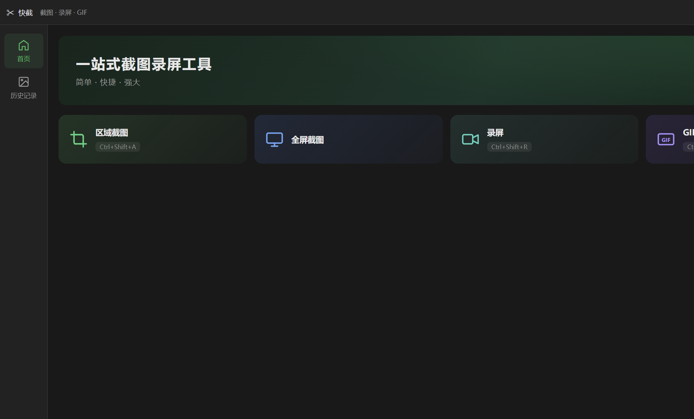
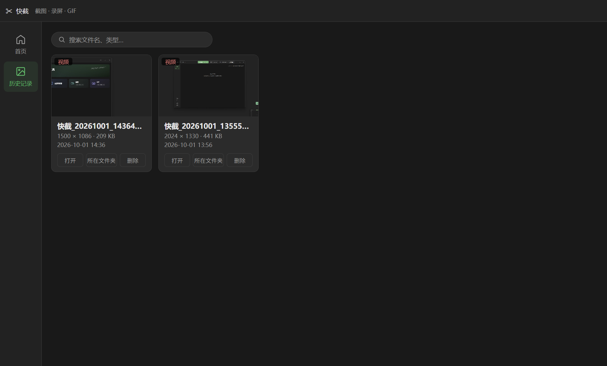
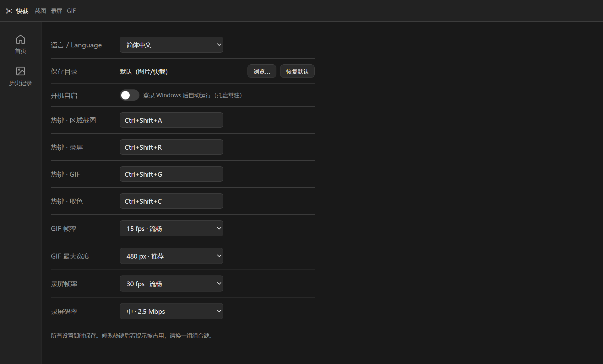

# 快截 KuaiJie

一站式屏幕工具：截图 · 标注 · 贴图 · 录屏 · GIF · 取色。

官网：https://kuaijie.mirrorsstores.com



## 功能

- **区域截图**：冻结快照框选，选区可拖动/八向调整，矩形/圆形/箭头/画笔/马赛克/文字六种标注，双击选区即完成复制
- **贴图钉住**：截图钉在屏幕最上层，可拖动，双击关闭，支持多张
- **录屏 MP4**：H.264（libopenh264），红框标示录制范围（录屏隐身不入镜），暂停/继续，帧率码率可调
- **GIF 录制**：框选即录，流式编码不吃内存，帧率/宽度可调
- **取色器**：10 倍放大镜，读取真实屏幕像素（无压缩色差），左键复制 HEX
- **历史记录**：自动归档，搜索 + 网格/列表视图
- **三语界面**：简体中文 / 繁體中文 / English
- **系统**：全局热键自定义（冲突检测）、托盘常驻、开机自启




## 技术栈

Rust + Tauri v2 · 前端原生 TS + Vite · SQLite（rusqlite）· FFmpeg LGPL 构建（sidecar 子进程）

## 本地开发

```bash
# 环境：Node 20+、Rust stable（MSVC）、VS Build Tools
pnpm install
pnpm tauri dev
```

### 录屏功能依赖 FFmpeg（需手动放置）

仓库不含 FFmpeg 二进制（体积超限）。下载 [BtbN 的 LGPL 静态构建](https://github.com/BtbN/FFmpeg-Builds/releases)（win64-lgpl），把 `ffmpeg.exe` 放到：

```
src-tauri/binaries/ffmpeg-x86_64-pc-windows-msvc.exe
```

## 打包发布

```powershell
pnpm tauri build          # 出 NSIS 安装包
powershell -File deploy.ps1   # 打包 + 传 R2 + 部署官网（需 wrangler login）
```

## 目录结构

```
├─ index.html / overlay.html / recordbar.html / pin.html / recframe.html
├─ src/                 # 前端（主界面/框选层/录制条/钉住窗/录制框/i18n）
├─ src-tauri/           # Rust 后端（截图/录制/设置/托盘/热键）
├─ website/             # 官网（静态页 + 三语 i18n）
└─ deploy.ps1           # 一键发版脚本
```

## 许可证

© 2026 OMNICATIFY. 保留所有权利。第三方组件见 THIRD_PARTY_LICENSES.md。
